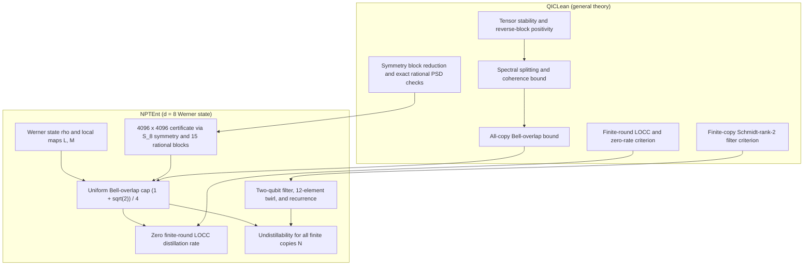

# NPTEnt

[](https://github.com/LionSR/NPTEnt/actions/workflows/ci.yml)
[](https://sirui-lu.com/NPTEnt/)
[](lean-toolchain)
[](scripts/check_no_admissions.py)
[](scripts/check_axioms.py)
[](https://arxiv.org/abs/2611.34921v1)
[](LICENSE)

A Lean 4 formalization of Islam Faisal, *Bound Entanglement with Negative Partial Transpose Exists* ([arXiv:2611.34921v1](https://arxiv.org/abs/2611.34921v1)), using [QICLean](https://github.com/LionSR/QICLean) and [Mathlib](https://github.com/leanprover-community/mathlib4).

Website: [sirui-lu.com/NPTEnt](https://sirui-lu.com/NPTEnt/) ([blueprint](https://sirui-lu.com/NPTEnt/blueprint/), [dependency graph](https://sirui-lu.com/NPTEnt/blueprint/dep_graph_document.html), [PDF](https://sirui-lu.com/NPTEnt/blueprint.pdf), [paper gaps](https://sirui-lu.com/NPTEnt/paper-gaps/)).

## Background and attribution

Whether every bipartite quantum state with negative partial transpose (NPT) can be distilled into Bell pairs by LOCC has been open since Horodecki, Horodecki, and Horodecki introduced bound entanglement in 1998. DiVincenzo, Shor, Smolin, Terhal, and Thapliyal (2000) and Dür, Cirac, Lewenstein, and Bruß (2000) conjectured that certain NPT Werner states are undistillable for every finite number of copies, and formulated the Schmidt-rank-two criterion for $N$-copy distillability. Shor, Smolin, and Terhal (2001) showed that bound-entangled NPT Werner states imply nonadditivity and nonconvexity of distillable entanglement.

This repository formalizes the construction and single-copy certificate of Islam Faisal ([arXiv:2611.34921v1](https://arxiv.org/abs/2611.34921v1)) over [QICLean](https://github.com/LionSR/QICLean), together with a self-contained Lean 4 proof of the Dür–Cirac–Lewenstein–Bruß all-$N$ undistillability criterion using two-qubit filtering and recurrence purification (following the two-qubit distillability reduction of Horodecki, Horodecki, and Horodecki, 1997).

## Verified results

The target state is the two-qudit Werner state

$$
\rho = \frac{23I - 3F}{1448} \qquad \text{on } \mathbb{C}^8 \otimes \mathbb{C}^8,
$$

where $F$ is the swap operator and $|u\rangle = \sum_{i=0}^{7} |i,i\rangle$. Every result below is verified in Lean 4 with no unfinished proofs, extra axioms, or external numerical solvers.

| Result | Statement | Lean declarations |
| :--- | :--- | :--- |
| State and NPT witness | $\rho \succeq 0$, $\operatorname{Tr}(\rho) = 1$, $\rho^{\Gamma}\vert u\rangle = -\vert u\rangle/1448$, NPT and entangled | [`rho_state_npt`](NPTEnt/Werner.lean), [`rho_not_isSeparable`](NPTEnt/Werner.lean) |
| Local-map factorization | $L(X) = 5\operatorname{Tr}(X)I - 3X^T$ and $M(X) = 18\operatorname{Tr}(X)I + 37X$ are completely positive, with $(L\otimes M)^{\otimes n}(\vert u_n\rangle\langle u_n\vert) = (37 \cdot 1448)^n \rho^{\otimes n}$ | [`L_isKrausCP`](NPTEnt/LocalMaps.lean), [`M_isKrausCP`](NPTEnt/LocalMaps.lean), [`piKronecker_rho_eq_smul_CCopies`](NPTEnt/LocalMaps.lean) |
| Single-copy certificate | $J + Q \succeq 0$, $J - Q \succeq 0$, $Q^{\Gamma_{\mathrm{in}}} \succeq 0$, and $(J - Q)(\vert u\rangle \otimes I) = 0$ on $(\mathbb{C}^8)^{\otimes 4}$ | [`appendixA_certificate`](NPTEnt/Certificate/Verification.lean), [`auxiliaryMapS_spec`](NPTEnt/Main.lean) |
| All-copy Bell-overlap cap | $\operatorname{Tr}(\Omega_2\,\Lambda(\rho^{\otimes N})) \le \frac{1+\sqrt{2}}{4}\operatorname{Tr}(\Lambda(\rho^{\otimes N}))$ for every $N \ge 1$ and every separable operation $\Lambda$ into two qubits | [`bellOverlap_separableOperation_le`](NPTEnt/Main.lean), [`bellOverlap_normalized_separableOperation_le`](NPTEnt/Main.lean), [`hasUniformBellOverlapCap_rho`](NPTEnt/Main.lean) |
| Finite-copy undistillability | $\langle\psi\vert(\rho^{\otimes N})^{T_A}\vert\psi\rangle \ge 0$ and $\langle\psi\vert(\rho^{\otimes N})^{T_B}\vert\psi\rangle \ge 0$ for every $N > 0$ and every vector $\psi$ of Schmidt rank at most $2$ | [`isFiniteCopyUndistillable_rho`](NPTEnt/Main.lean), [`npt_finiteCopyUndistillable`](NPTEnt/Main.lean) |
| Zero finite-round LOCC rate | $E_D(\rho) = 0$ for finite-round LOCC with finitely many outcomes | [`distillableEntanglement_isBipartiteFiniteRoundLOCC_rho_eq_zero`](NPTEnt/Main.lean), [`npt_zero_finiteRoundLOCC_distillableEntanglement`](NPTEnt/Main.lean) |

The two combined theorems in [`NPTEnt/Main.lean`](NPTEnt/Main.lean) are:

```lean
theorem npt_finiteCopyUndistillable :
    Werner.rho.PosSemidef ∧
    Werner.rho.trace = 1 ∧
    ¬ (partialTransposeRight Werner.rho).PosSemidef ∧
    ¬ Matrix.IsSeparable Werner.rho ∧
    QuantumInfo.IsFiniteCopyUndistillable Werner.rho

theorem npt_zero_finiteRoundLOCC_distillableEntanglement :
    Werner.rho.PosSemidef ∧
    Werner.rho.trace = 1 ∧
    ¬ (partialTransposeRight Werner.rho).PosSemidef ∧
    ¬ Matrix.IsSeparable Werner.rho ∧
    QuantumCircuit.HasUniformBellOverlapCap Werner.rho ((1 + Real.sqrt 2) / 4) ∧
    QuantumCircuit.distillableEntanglement
      QuantumCircuit.IsBipartiteFiniteRoundLOCC Werner.rho = 0
```

Both theorems follow from the uniform Bell-overlap bound $(1 + \sqrt{2})/4 < 1$ by separate arguments. Finite-copy undistillability is proved via two-qubit filtering ([`TwoQubitDistillability.lean`](NPTEnt/TwoQubitDistillability.lean)), a 12-element finite isotropic twirl and parity filter ([`QubitRecurrence.lean`](NPTEnt/QubitRecurrence.lean)), and recurrence amplification of $g(f) = (10f^2 - 2f + 1)/(8f^2 - 4f + 5)$ ([`RecurrenceAmplification.lean`](NPTEnt/RecurrenceAmplification.lean)); it is not deduced from rate zero (see [finite-copy undistillability](docs/finite-copy-undistillability.md)). The rate theorem covers finite-round LOCC with finitely many outcomes. Infinite-round LOCC, its closure, and downstream activation, nonadditivity, and nonconvexity consequences are not claimed here.

## Proof overview

General entanglement theory lives in [QICLean](https://github.com/LionSR/QICLean); the explicit $d = 8$ Werner state, certificate verification, and two-qubit purification bridge live in `NPTEnt`.



For the $4096 \times 4096$ certificate ([`Operators.lean`](NPTEnt/Certificate/Operators.lean)), [`Symmetry.lean`](NPTEnt/Certificate/Symmetry.lean) proves symbolically that $40(J \pm Q)$ and $40Q^{\Gamma_{\mathrm{in}}}$ are invariant under simultaneous $S_8$ basis permutations and split into $708$ independent blocks covering all $4096$ basis states (of sizes $1, 3, 6, 22, 42$). Permutation symmetry reduces each matrix to $5$ representative blocks ($15$ in total). [`Blocks.lean`](NPTEnt/Certificate/Blocks.lean) and [`Verification.lean`](NPTEnt/Certificate/Verification.lean) verify positivity of each block in Lean via exact rational $LDL^T$ factorizations, and verify $(J - Q)(|u\rangle \otimes I) = 0$ directly.

## Additional candidates

Beyond the baseline state $\rho$, [`scripts/check_additional_certificates.py`](scripts/check_additional_certificates.py) checks exact rational single-copy certificates for three further NPT states: $\rho(8, -75/569)$, $\rho(9, -125/1004)$, and a non-Werner perturbation at $d = 8$. Related depolarization, filtering, higher-dimensional, and interpolation families are discussed in [additional candidates](docs/additional-candidates.md) and [example families](docs/example-families.md). These are exact computational checks and mathematical notes, not Lean proofs.

## Build and verify

Install [`elan`](https://github.com/leanprover/elan) and Python 3.10 or newer, then fetch the Mathlib cache and build:

```sh
lake exe cache get
lake build
python3 scripts/check_no_admissions.py
python3 scripts/check_axioms.py
```

The verification scripts confirm that the Lean proofs contain no unfinished steps or extra axioms. Dependencies are pinned for Lean and Mathlib `v4.36.0-rc1`.

## References

- R. F. Werner, *Quantum states with Einstein-Podolsky-Rosen correlations admitting a hidden-variable model*, Phys. Rev. A 40, 4277 (1989). [doi:10.1103/PhysRevA.40.4277](https://doi.org/10.1103/PhysRevA.40.4277)
- A. Peres, *Separability criterion for density matrices*, Phys. Rev. Lett. 77, 1413 (1996). [doi:10.1103/PhysRevLett.77.1413](https://doi.org/10.1103/PhysRevLett.77.1413)
- M. Horodecki, P. Horodecki, and R. Horodecki, *Inseparable two spin-1/2 density matrices can be distilled to a singlet form*, Phys. Rev. Lett. 78, 574 (1997). [doi:10.1103/PhysRevLett.78.574](https://doi.org/10.1103/PhysRevLett.78.574)
- M. Horodecki, P. Horodecki, and R. Horodecki, *Mixed-state entanglement and distillation: Is there a "bound" entanglement in nature?*, Phys. Rev. Lett. 80, 5239 (1998). [doi:10.1103/PhysRevLett.80.5239](https://doi.org/10.1103/PhysRevLett.80.5239)
- D. P. DiVincenzo, P. W. Shor, J. A. Smolin, B. M. Terhal, and A. V. Thapliyal, *Evidence for bound entangled states with negative partial transpose*, Phys. Rev. A 61, 062312 (2000). [doi:10.1103/PhysRevA.61.062312](https://doi.org/10.1103/PhysRevA.61.062312)
- W. Dür, J. I. Cirac, M. Lewenstein, and D. Bruß, *Distillability and partial transposition in bipartite systems*, Phys. Rev. A 61, 062313 (2000). [doi:10.1103/PhysRevA.61.062313](https://doi.org/10.1103/PhysRevA.61.062313)
- P. W. Shor, J. A. Smolin, and B. M. Terhal, *Nonadditivity of bipartite distillable entanglement follows from a conjecture on bound entangled Werner states*, Phys. Rev. Lett. 86, 2681 (2001). [doi:10.1103/PhysRevLett.86.2681](https://doi.org/10.1103/PhysRevLett.86.2681)
- P. Horodecki, Ł. Rudnicki, and K. Życzkowski, *Five open problems in quantum information theory*, PRX Quantum 3, 010101 (2022). [doi:10.1103/PRXQuantum.3.010101](https://doi.org/10.1103/PRXQuantum.3.010101)
- Islam Faisal, *Bound Entanglement with Negative Partial Transpose Exists*, [arXiv:2611.34921v1](https://arxiv.org/abs/2611.34921v1) (2026).

## License

Repository code is released under the [Apache License 2.0](LICENSE). Started from [oh-my-formalization](https://github.com/LionSR/oh-my-formalization).
